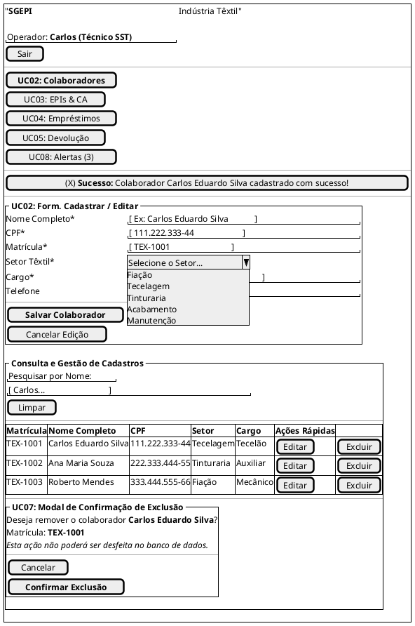

# 🛠️ Documentação Técnica: Sistema de Gerenciamento de EPIs (SST Têxtil)


---

## 1. Visão Geral do Sistema

O **Sistema de Gerenciamento de EPIs (SGEPI)** visa automatizar, controlar e auditar o fluxo de empréstimo e devolução de Equipamentos de Proteção Individual no setor têxtil. O foco central da solução é assegurar a conformidade legal com a **NR-06**, evitar paralisações por falta de equipamentos e garantir a rastreabilidade total das entregas por colaborador.

---

## 2. Estrutura de Pastas do Projeto

```text
sgepi-v2/
├── database/
│   └── banco_de_dados.sql    # Script SQL atualizado com DDL e Povoamento
├── node_modules/             # Dependências do Node.js
├── public/                   # Arquivos estáticos servidos pelo Express
│   ├── css/
│   │   └── style.css         # Estilização global do sistema
│   ├── js/
│   │   ├── app.js            # Script principal da interface interativa
│   │   └── login.js          # Lógica de autenticação do lado do cliente
│   ├── index.html            # Dashboard e gestão de colaboradores/EPIs
│   └── login.html            # Tela de login e controle de acesso
├── .env                      # Variáveis de ambiente (DB Host, Port, JWT, etc.)
├── .gitignore                # Arquivos ignorados pelo Git
├── package.json              # Configurações do projeto e pacotes npm
├── server.js                 # Servidor Backend em Node.js / Express
└── README.md                 # Documentação completa do projeto
```

---

## 3. Requisitos do Sistema

### 3.1 Requisitos - Projeto IDEAL

#### Requisitos Funcionais (RF)
* **RF01 - Autenticação de Usuário (UC01):** Permitir login seguro para Técnicos de SST e Operadores com controle de sessão.
* **RF02 - Cadastro e Edição de Colaboradores (UC02):** Inclusão e atualização de dados (Nome, CPF, Matrícula, Setor Têxtil, Cargo, Telefone e Status).
* **RF03 - Consulta e Busca de Colaboradores (UC06):** Filtragem dinâmica por nome ou matrícula.
* **RF04 - Exclusão Protegida de Colaboradores (UC07):** Confirmação via modal/alerta prévio antes da remoção ou desativação.
* **RF05 - Cadastro e Controle de EPIs (UC03):** Registro de equipamentos, número do CA (`ca_numero`), estoque disponível e data de validade do Certificado de Aprovação.
* **RF06 - Empréstimo e Retirada de EPI (UC04):** Registro de saídas associando colaborador, equipamento, data, hora e responsável. Bloqueio de itens com CA vencido ou estoque zerado.
* **RF07 - Devolução de EPI (UC05):** Registro de devolução e atualização do status da entrega (`EMPRESTADO`, `DEVOLVIDO`, `ATRASADO`).
* **RF08 - Gestão de Pendências e Alertas (UC08):** Painel com notificações de itens pendentes, vencimento de vida útil e CAs prestes a expirar.

#### Requisitos Não Funcionais (RNF)
* **RNF01 - Interface Intuitiva de Campo:** UI responsiva e com poucos cliques para uso rápido no chão de fábrica.
* **RNF02 - Mapeamento Visual de Ações Críticas:** Destaque em cores de alerta para exclusões e descarte de material.
* **RNF03 - Desempenho e Eficiência:** Tempo de resposta inferior a 2 segundos em pesquisas e gravações.
* **RNF04 - Rastreabilidade de Operações:** Manutenção de logs de auditoria imutáveis para atendimento à NR-06.
* **RNF05 - Proteção de Dados (LGPD):** Criptografia e tratamento seguro para dados sensíveis (CPF, matrícula).
* **RNF06 - Proteção de Acesso:** Bloqueio de rotas não autorizadas via middlewares de autenticação.
* **RNF07 - Integridade das Informações:** Impedimento de duplicação de cadastros ativos por CPF ou Matrícula. Restrições com `ON DELETE RESTRICT` nas chaves estrangeiras.

---

### 3.2 Requisitos - PROTÓTIPO REALIZADO

#### Requisitos Funcionais (RF)
* **RF-01: Cadastro de Colaborador**
  * **Descrição:** Cadastrar colaborador informando nome, CPF, matrícula, setor têxtil e cargo.
  * **Módulo:** Colaboradores | **Prioridade:** Alta | **Regra:** CPF e Matrícula únicos.
* **RF-02: Edição e Status de Colaborador**
  * **Descrição:** Editar dados cadastrais e status (Ativo/Inativo) do colaborador.
  * **Módulo:** Colaboradores | **Prioridade:** Alta | **Regra:** Preservar histórico.
* **RF-03: Pesquisa Dinâmica**
  * **Descrição:** Filtrar/pesquisar colaboradores dinamicamente pelo nome na listagem.
  * **Módulo:** Colaboradores | **Prioridade:** Alta | **Regra:** Busca em tempo real.
* **RF-04: Exclusão com Validação**
  * **Descrição:** Excluir colaborador do sistema com confirmação e validação de vínculo.
  * **Módulo:** Colaboradores | **Prioridade:** Alta | **Regra:** Bloquear se houver EPI pendente.
* **RF-05: Controle de Estoque de EPIs**
  * **Descrição:** Cadastrar e controlar estoque de EPIs vinculando o número do CA e validade.
  * **Módulo:** Estoque EPI | **Prioridade:** Média | **Regra:** Bloquear entrega de CA vencido.
* **RF-06: Movimentação de EPIs**
  * **Descrição:** Registrar empréstimo e devolução de EPIs para colaboradores.
  * **Módulo:** Movimentação | **Prioridade:** Média | **Regra:** Baixa automática de estoque.

#### Requisitos Não Funcionais (RNF)
* **RNF-01: Interface Responsiva**
  * **Descrição:** Interface responsiva otimizada para desktops e tablets de fábrica.
  * **Métrica:** Bootstrap 5 / Flexbox / CSS Modulazado.
* **RNF-02: Desempenho de Consulta**
  * **Descrição:** Tempo de resposta da consulta de colaboradores inferior a 200ms.
  * **Métrica:** Indexação B-Tree MySQL / API REST em Node.js.
* **RNF-03: Integridade de Dados**
  * **Descrição:** Persistência de dados com integridade referencial ACID.
  * **Métrica:** Engine InnoDB MySQL com chaves estrangeiras (`ON DELETE RESTRICT`).
* **RNF-04: Arquitetura Modular**
  * **Descrição:** Separação clara entre backend (API Express) e frontend estático (HTML/JS/CSS).
  * **Métrica:** Node.js, Express, MySQL2.

---

## 4. Modelagem do Banco de Dados (DDL)

O modelo de banco de dados e as operações projetadas para o SGEPI utilizam o conceito de **CRUD** (Create, Read, Update, Delete):

* **Create (Criar/Inserir):** Comando `INSERT INTO` (Mapeado nos RF-01 e RF-05 para cadastros de colaboradores e EPIs).
* **Read (Ler/Consultar):** Comando `SELECT` (Mapeado no RF-03 para consultas e filtros dinâmicos).
* **Update (Atualizar/Alterar):** Comando `UPDATE` (Mapeado no RF-02 e RF-06 para edições cadastrais e devolução/baixa de estoque).
* **Delete (Eliminar/Remover):** Comando `DELETE` ou exclusão lógica `UPDATE status = 'INATIVO'` (Mapeado no RF-04).

---

### 4.1 Script de Banco de Dados - PROTÓTIPO REALIZADO

Este é o script principal localizado em `database/banco_de_dados.sql`:

```sql
-- =============================================================================
-- SISTEMA DE GERENCIAMENTO DE EPIS (SGEPI) - INDÚSTRIA TÊXTIL
-- SCRIPT DE CRIAÇÃO DO BANCO DE DADOS E TABELAS NO MYSQL WORKBENCH
-- =============================================================================

CREATE DATABASE IF NOT EXISTS `sgepi_db`
    DEFAULT CHARACTER SET utf8mb4
    DEFAULT COLLATE utf8mb4_unicode_ci;

USE `sgepi_db`;

-- -----------------------------------------------------------------------------
-- Tabela: usuarios
-- -----------------------------------------------------------------------------
CREATE TABLE IF NOT EXISTS `usuarios` (
  `id` INT NOT NULL AUTO_INCREMENT,
  `nome` VARCHAR(100) NOT NULL,
  `email` VARCHAR(100) NOT NULL,
  `senha_hash` VARCHAR(255) NOT NULL,
  `perfil` ENUM('ADMIN', 'TECNICO_SST', 'OPERADOR') NOT NULL DEFAULT 'TECNICO_SST',
  `ativo` TINYINT(1) NOT NULL DEFAULT 1,
  `criado_em` DATETIME NOT NULL DEFAULT CURRENT_TIMESTAMP,
  PRIMARY KEY (`id`),
  UNIQUE INDEX `uk_usuarios_email` (`email` ASC)
) ENGINE = InnoDB DEFAULT CHARSET = utf8mb4 COLLATE = utf8mb4_unicode_ci;

-- -----------------------------------------------------------------------------
-- Tabela: colaboradores
-- -----------------------------------------------------------------------------
CREATE TABLE IF NOT EXISTS `colaboradores` (
  `id` INT NOT NULL AUTO_INCREMENT,
  `nome` VARCHAR(100) NOT NULL,
  `cpf` VARCHAR(14) NOT NULL,
  `matricula` VARCHAR(20) NOT NULL,
  `setor` ENUM('Fiação', 'Tecelagem', 'Tinturaria', 'Acabamento', 'Manutenção') NOT NULL,
  `cargo` VARCHAR(50) NOT NULL,
  `telefone` VARCHAR(20) NULL,
  `status` ENUM('ATIVO', 'INATIVO') NOT NULL DEFAULT 'ATIVO',
  `criado_em` DATETIME NOT NULL DEFAULT CURRENT_TIMESTAMP,
  `atualizado_em` DATETIME NULL ON UPDATE CURRENT_TIMESTAMP,
  PRIMARY KEY (`id`),
  UNIQUE INDEX `uk_colaboradores_cpf` (`cpf` ASC),
  UNIQUE INDEX `uk_colaboradores_matricula` (`matricula` ASC),
  INDEX `idx_colaboradores_nome` (`nome` ASC)
) ENGINE = InnoDB DEFAULT CHARSET = utf8mb4 COLLATE = utf8mb4_unicode_ci;

-- -----------------------------------------------------------------------------
-- Tabela: epis
-- -----------------------------------------------------------------------------
CREATE TABLE IF NOT EXISTS `epis` (
  `id` INT NOT NULL AUTO_INCREMENT,
  `nome` VARCHAR(100) NOT NULL,
  `ca_numero` VARCHAR(30) NOT NULL,
  `descricao` TEXT NULL,
  `quantidade_estoque` INT NOT NULL DEFAULT 0,
  `validade_ca` DATE NOT NULL,
  `criado_em` DATETIME NOT NULL DEFAULT CURRENT_TIMESTAMP,
  PRIMARY KEY (`id`),
  UNIQUE INDEX `uk_epis_ca_numero` (`ca_numero` ASC)
) ENGINE = InnoDB DEFAULT CHARSET = utf8mb4 COLLATE = utf8mb4_unicode_ci;

-- -----------------------------------------------------------------------------
-- Tabela: emprestimos
-- -----------------------------------------------------------------------------
CREATE TABLE IF NOT EXISTS `emprestimos` (
  `id` INT NOT NULL AUTO_INCREMENT,
  `colaborador_id` INT NOT NULL,
  `epi_id` INT NOT NULL,
  `usuario_id` INT NOT NULL,
  `data_retirada` DATETIME NOT NULL DEFAULT CURRENT_TIMESTAMP,
  `data_devolucao_prevista` DATE NOT NULL,
  `data_devolucao_real` DATETIME NULL,
  `quantidade` INT NOT NULL DEFAULT 1,
  `status` ENUM('EMPRESTADO', 'DEVOLVIDO', 'ATRASADO') NOT NULL DEFAULT 'EMPRESTADO',
  `condicao_devolucao` ENUM('PERFEITO', 'DANIFICADO', 'DESCARTE', 'HIGIENIZACAO') NULL,
  `observacao` VARCHAR(255) NULL,
  PRIMARY KEY (`id`),
  INDEX `fk_emprestimos_colaboradores_idx` (`colaborador_id` ASC),
  INDEX `fk_emprestimos_epis_idx` (`epi_id` ASC),
  INDEX `fk_emprestimos_usuarios_idx` (`usuario_id` ASC),
  CONSTRAINT `fk_emprestimos_colaboradores`
    FOREIGN KEY (`colaborador_id`) REFERENCES `colaboradores` (`id`)
    ON DELETE RESTRICT ON UPDATE CASCADE,
  CONSTRAINT `fk_emprestimos_epis`
    FOREIGN KEY (`epi_id`) REFERENCES `epis` (`id`)
    ON DELETE RESTRICT ON UPDATE CASCADE,
  CONSTRAINT `fk_emprestimos_usuarios`
    FOREIGN KEY (`usuario_id`) REFERENCES `usuarios` (`id`)
    ON DELETE RESTRICT ON UPDATE CASCADE
) ENGINE = InnoDB DEFAULT CHARSET = utf8mb4 COLLATE = utf8mb4_unicode_ci;

-- -----------------------------------------------------------------------------
-- DADOS INICIAIS DE TESTE (POVOAMENTO SEED)
-- -----------------------------------------------------------------------------
INSERT INTO `usuarios` (`nome`, `email`, `senha_hash`, `perfil`) VALUES
('Administrador SST', 'admin@textil.com.br', '$2a$10$wT8v0G5Xp4A98xPZmQeAuuE4aK3mS1J6G7/3O7T5Z2Q1M9Xy0W5Ke', 'ADMIN'),
('Carlos Oliveira', 'carlos.sst@textil.com.br', '$2a$10$wT8v0G5Xp4A98xPZmQeAuuE4aK3mS1J6G7/3O7T5Z2Q1M9Xy0W5Ke', 'TECNICO_SST');

INSERT INTO `colaboradores` (`nome`, `cpf`, `matricula`, `setor`, `cargo`, `telefone`) VALUES
('Carlos Eduardo Silva', '111.222.333-44', 'TEX-1001', 'Tecelagem', 'Operador de Tecelagem', '(75) 98888-1111'),
('Ana Maria Souza', '222.333.444-55', 'TEX-1002', 'Tinturaria', 'Auxiliar de Tinturaria', '(75) 98888-2222'),
('Roberto Mendes', '333.444.555-66', 'TEX-1003', 'Fiação', 'Mecânico de Manutenção', '(75) 98888-3333');

INSERT INTO `epis` (`nome`, `ca_numero`, `descricao`, `quantidade_estoque`, `validade_ca`) VALUES
('Protetor Auricular Plug de Silicone', 'CA-12345', 'Atenuação de ruído para áreas de tecelagem e fiação', 150, '2027-12-31'),
('Máscara PFF2 contra Poeiras Têxteis', 'CA-67890', 'Proteção respiratória contra névoas e poeiras de algodão', 300, '2026-10-15'),
('Luva de Nitrila para Manipulação Química', 'CA-11223', 'Proteção das mãos no setor de tinturaria e acabamento', 80, '2028-05-20'),
('Óculos de Proteção Incolor Anti-risco', 'CA-44556', 'Proteção ocular contra impactos de partículas volantes', 100, '2027-08-10');

INSERT INTO `emprestimos` (`colaborador_id`, `epi_id`, `usuario_id`, `data_devolucao_prevista`, `quantidade`, `status`) VALUES
(1, 1, 1, '2026-11-01', 1, 'EMPRESTADO'),
(2, 3, 1, '2026-10-15', 1, 'EMPRESTADO');
```

---

## 5. Diagramas do Sistema (PlantUML)

### 5.1 Diagrama de Casos de Uso

```plantuml
@startuml
skinparam {
    Style strictuml
    RoundCorner 12
    Shadowing true
    DefaultFontName "Segoe UI", "Arial"
    DefaultFontSize 13
}

actor "Técnico de SST /\n Operador" as Tecnico

rectangle "Sistema de Gerenciamento de EPIs (SST Têxtil)" {
    
    package "Acesso & Segurança" #ECEFF1 {
        usecase "UC01: Autenticar no Sistema" as UC1
    }

    package "Gestão de Cadastros" #F1F5F9 {
        usecase "UC02: Gerenciar Colaboradores\n(Criar, Editar, Listar)" as UC2
        usecase "UC06: Pesquisar Colaborador\npor Nome" as UC6
        usecase "UC07: Confirmar Exclusão\nde Colaborador" as UC7
        usecase "UC03: Gerenciar EPIs e CA\n(Validade e Estoque)" as UC3
    }

    package "Operações Diárias de Campo" #F1F5F9 {
        usecase "UC04: Registrar Empréstimo de EPI" as UC4
        usecase "UC05: Registrar Devolução de EPI" as UC5
        usecase "UC08: Consultar Pendências\ne Alertas de Retirada" as UC8
    }

    Tecnico --> UC1
    Tecnico --> UC2
    Tecnico --> UC3
    Tecnico --> UC4
    Tecnico --> UC5
    Tecnico --> UC8

    UC2 .> UC1 : <<include>>
    UC3 .> UC1 : <<include>>
    UC4 .> UC1 : <<include>>
    UC5 .> UC1 : <<include>>

    UC2 .> UC6 : <<include>>
    UC7 .> UC2 : <<extend>>
}
@uml
```

---

### 5.2 Mapeamento de Interface (Wireframe PlantUML Salt)



---

## 6. Endpoints da API REST (Node.js + Express)

| Método | Endpoint | Descrição |
| :--- | :--- | :--- |
| `POST` | `/api/login` | Autenticação de usuários com geração de token/sessão |
| `GET` | `/api/colaboradores` | Listagem e pesquisa dinâmica de colaboradores |
| `POST` | `/api/colaboradores` | Cadastrar novo colaborador |
| `PUT` | `/api/colaboradores/:id` | Editar cadastro de colaborador existente |
| `DELETE` | `/api/colaboradores/:id` | Excluir colaborador com verificação de pendências |
| `GET` | `/api/epis` | Consultar catálogo de EPIs e saldos em estoque |
| `POST` | `/api/emprestimos` | Registrar empréstimo de EPI para colaborador |
| `PUT` | `/api/emprestimos/:id/devolucao` | Registrar devolução de EPI |

---

## 7. Como Executar o Projeto

### Pré-requisitos
* **Node.js** (versão 18 ou superior)
* **MySQL Server / MySQL Workbench** (versão 8.0)
* **Git**

### Passo a Passo

1. **Clonar o Repositório:**
   ```bash
   git clone https://github.com/deboraNicoleEstrela/sgepi-v2.git
   cd sgepi-v2
   ```

2. **Instalar Dependências:**
   ```bash
   npm install
   ```

3. **Configurar o Banco de Dados:**
   * Abra o **MySQL Workbench**.
   * Execute o script contido em `database/banco_de_dados.sql`.

4. **Configurar Variáveis de Ambiente (`.env`):**
   Crie ou edite o arquivo `.env` na raiz do projeto:
   ```env
   PORT=3000
   DB_HOST=localhost
   DB_USER=root
   DB_PASS=sua_senha_mysql
   DB_NAME=sgepi_db
   ```

5. **Iniciar o Servidor:**
   ```bash
   node server.js
   ```

6. **Acessar a Aplicação:**
   Abra o navegador em `http://localhost:3000/login.html`.

---

## 8. Credenciais Padrão para Teste

| Perfil | Email | Senha |
| :--- | :--- | :--- |
| **Administrador** | `admin@textil.com.br` | `Admin1234` |
| **Técnico SST** | `carlos.sst@textil.com.br` | `Admin1234` |

---

## 📄 Licença
Este projeto está sob a licença **MIT**.